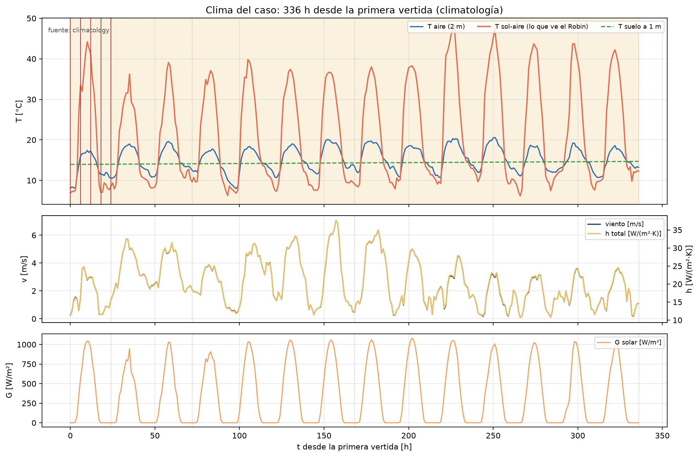
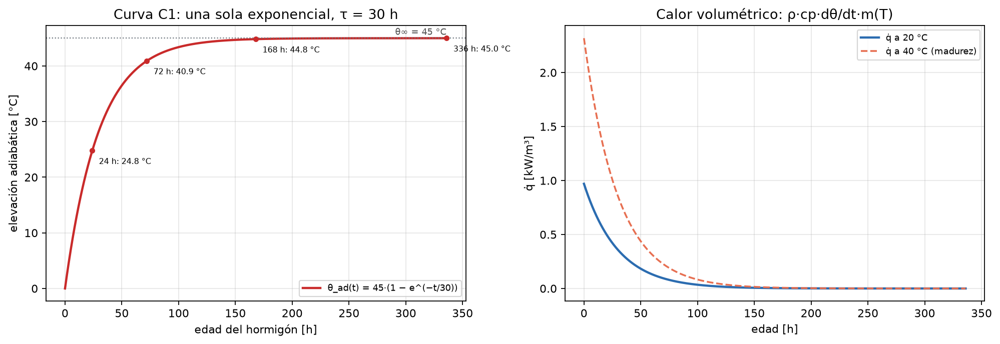
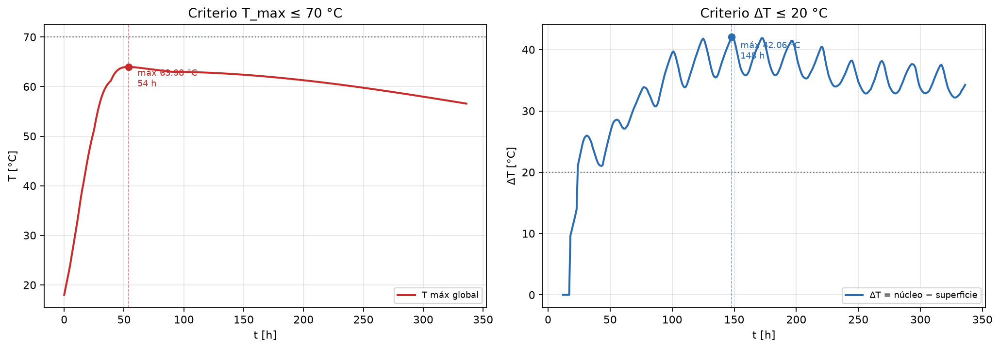
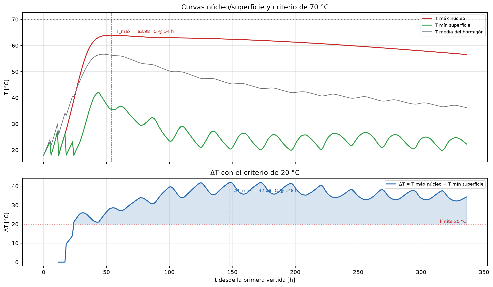
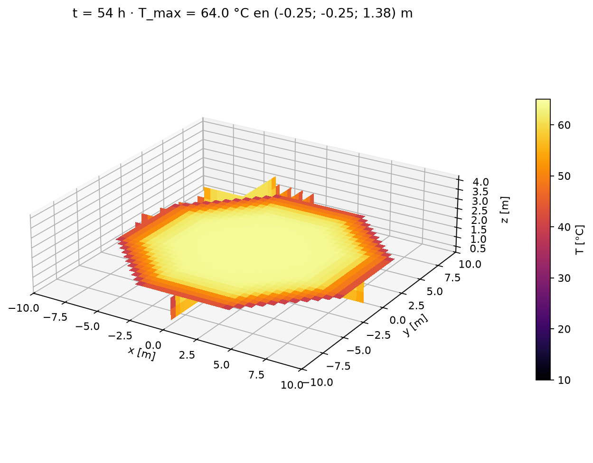
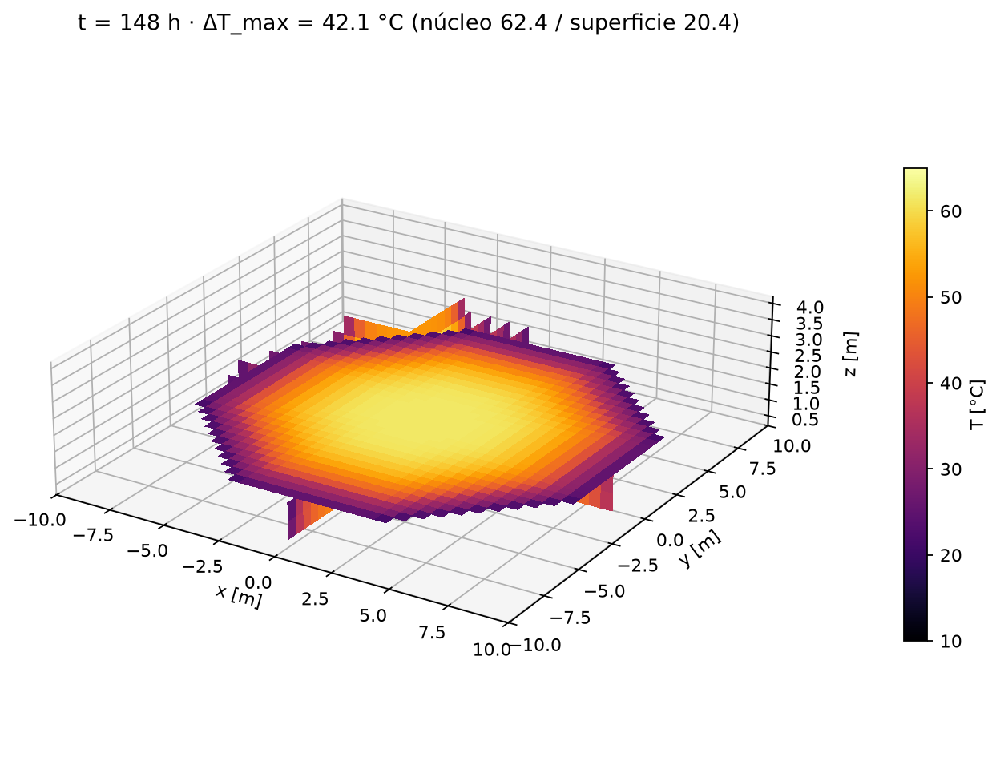
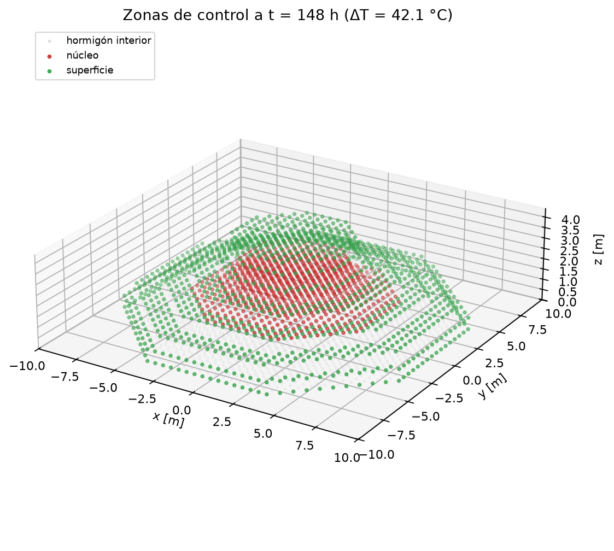

# E12 — Simulación determinista de 14 días

**Grupo 5:** José Lobos, Clemente Sánchez y Matías Campos

**Repositorio:** https://github.com/jlobos-alt/MCOC-proyecto-2

**Commit evaluado:** 5aa4bfa

**Fecha:** viernes 13 de noviembre de 2026

**Caso:** fundación del IFC, 5 vertidas, 336 h desde el 27-nov-2026 04:00

## 1. Resumen

Un único caso determinista: misma geometría, plan de vertidas, clima y una sola curva de hidratación. La malla es de 0,5 m en planta y 0,55 m en altura (36×36×8, 4656 celdas activas, error de volumen 0,52 %). La temperatura máxima es **63,98 °C a las 54 h** y cumple el límite de 70 °C con 6,02 °C de margen. El diferencial núcleo-superficie llega a **42,06 °C a las 148 h**, 2,1 veces el límite de 20 °C: **el plan no cumple**. El ΔT supera los 20 °C desde las 24 h y no vuelve a bajar en toda la ventana.

## 2. Curva de hidratación (una sola)

Se usa la curva **C1**, única declarada en el modelo desde E09: θ_ad(a) = 45·(1 − e^(−a/30)) °C, con madurez de Arrhenius Ea/R = 4000 K y T_ref = 20 °C, sin segunda rama exponencial (θ∞₂ = 0). La curva se evalúa con la edad equivalente, de modo que el calor total no depende de la temperatura: el hormigón caliente libera lo mismo, pero antes. Da θ_ad(24 h) = 24,78 °C, θ_ad(168 h) = 44,83 °C y q̇(0) = 0,97 kW/m³.

$$θ_ad(a) = θ∞ (1 − e^(−a/τ)),    q̇_h = ρ c_p (dθ_ad/da) · m(T)$$

Cambiar de curva es editar θ∞, τ y Ea/R en `datos/fundacion_e12.yaml`; el resto no cambia. No se mezclan curvas ni se usan ramas por vertida.

## 3. Clima: dataset, timestamp y horizonte no cubierto

Dos snapshots inmutables de Open-Meteo, verificados por SHA-256 antes de simular:

| Snapshot | Contenido | Horizonte | SHA-256 (csv) |
|---|---:|---:|---:|
| 20261111T193622Z_open-meteo-forecast | forecast best_match, Pahuil/Chanco; emitido 2026-11-11 19:36:22 UTC | 2026-11-11 00:00 → 2026-11-24 23:00 (336 h) | `ba1d71b5…` |
| 20261111T193623Z_open-meteo-archive | reanalysis ERA5 del mismo calendario | 2025-11-27 00:00 → 2025-12-11 23:00 (360 h) | `f4377629…` |

**Horizonte no cubierto.** La primera vertida es el 27-nov-2026 a las 04:00 y el forecast disponible termina el 24-nov: no aporta ninguna hora. Las 336 h se completan con la climatología del archivo, desplazada al año del caso (2026), hora a hora y sin interpolar entre años. Cada fila de `series_e12.csv` declara su fuente: **0 h de forecast y 337 puntos de climatología**, sin horas faltantes. Un forecast que cubra la ventana reemplaza ese bloque sin tocar el resto. El archivo usado da aire 8,0–20,6 °C, viento medio 2,57 m/s (máx 7,06), radiación máxima 1081 W/m², h = 10,65–37,63 W/(m²·K) y T sol-aire máxima 47,96 °C.

## 4. Condiciones de borde

Robin lateral y superior; base conductiva semi-infinita:

| Frontera | Tipo | Parámetros |
|---|---:|---:|
| Lateral y superior | Robin | −k∂T/∂n = h(t)·(T − T∞); h = 5,7 + 3,8v + 4εσT³; T∞ = T sol-aire; α = 0,6; ε = 0,9 |
| Moldaje | Capa en serie | madera 19 mm, k = 0,12 → R = 0,158 m²K/W; se retira 72 h después de cada vertida |
| Base | Robin conductivo | R = e/k = 1,0/1,389 = 0,72 m²K/W; T∞ = suelo a 1 m (onda anual, amortiguación 0,69, atraso 517 h) |
| Inicial | Dirichlet | T = 18 °C al colocar cada vertida |
| Fuente | Volumétrica | q̇ de la curva C1 con madurez de Arrhenius |

Muestras de la serie que recibe el Robin:

| t [h] | Hora local | T aire [°C] | v [m/s] | G [W/m²] | h [W/m²K] | T∞ [°C] | T suelo [°C] |
|---|---:|---:|---:|---:|---:|---:|---:|
| 0 | 04:00 | 8,1 | 0,25 | 0 | 11,2 | 6,9 | 13,9 |
| 12 | 16:00 | 17,3 | 2,98 | 955 | 22,0 | 41,2 | 14,0 |
| 24 | 04:00 | 10,5 | 1,35 | 0 | 15,5 | 8,6 | 14,0 |
| 72 | 04:00 | 12,5 | 2,09 | 0 | 18,4 | 9,6 | 14,1 |
| 168 | 04:00 | 13,5 | 0,47 | 0 | 12,3 | 9,1 | 14,3 |
| 336 | 04:00 | 13,2 | 1,10 | 0 | 14,7 | 12,2 | 14,7 |

## 5. Plan de vertidas

El plan sale del IFC (horas, temperatura, moldaje y retiro por vertida); el script no contiene datos de obra:

| V | Inicio [h] | Hora local | T col. [°C] | z [m] | Moldaje | Retiro [h] |
|---|---:|---:|---:|---:|---:|---:|
| 1 | 0 | 04:00 | 18,0 | 0,00–0,55 | Madera | 72 |
| 2 | 6 | 10:00 | 18,0 | 0,55–1,10 | Madera | 72 |
| 3 | 12 | 16:00 | 18,0 | 1,10–2,20 | Madera | 72 |
| 4 | 18 | 22:00 | 18,0 | 2,20–3,30 | Madera | 72 |
| 5 | 24 | 04:00 | 18,0 | 3,30–4,30 | Madera | 72 |

Las cinco vertidas suman 636,89 m³ según los Pset del IFC. Todas usan madera sin aislación.

## 6. Resultados: criterios de 70 °C y 20 °C

| Criterio | Límite [°C] | Valor [°C] | Instante | Veredicto |
|---|---:|---:|---:|---:|
| T_max | 70 | 63,98 | 54 h · 2026-11-29 10:00 | **cumple** |
| ΔT_max | 20 | 42,06 | 148 h · 2026-12-03 08:00 | **no cumple** |

**T_max = 63,98 °C a las 54 h** (2026-11-29 10:00) en la celda (-0,25; -0,25; 1,38) m, en el eje del pedestal (V3). Es 6,02 °C bajo el límite; el hormigón pasa 208 h sobre 60 °C.

**ΔT_max = 42,06 °C a las 148 h** (2026-12-03 08:00). El núcleo más caliente está en (-0,25; -0,25; 1,93) m con 62,43 °C (V3), y la superficie más fría en (-8,75; -3,75; 0,82) m con 20,38 °C (V2), sobre la cara lateral del octágono. El ΔT supera 20 °C en 313 de las 337 horas registradas: empieza a las 24 h y sigue sobre el límite al terminar la ventana (34,26 °C a las 336 h).

La temperatura máxima por vertida es V1 57,03 °C (43 h), V2 61,96 °C (50 h), V3 63,98 °C (54 h), V4 63,27 °C (64 h) y V5 61,56 °C (62 h): el pico lo fija la acumulación de V1–V3 en el centro del bloque.

## 7. Curvas núcleo/superficie y visualización 3D



*Figura 1. Clima del caso: aire, sol-aire, suelo y h(t) en las 336 h (todo climatología).*



*Figura 2. Curva C1: elevación adiabática y calor volumétrico con madurez.*



*Figura 3. T_max(t) contra 70 °C y ΔT(t) contra 20 °C.*

El núcleo sube rápido y se enfría lento: 63,98 °C a las 54 h y 56,58 °C al final. La superficie sigue el ciclo diario y el retiro del moldaje: 35,53 °C a las 54 h y 20,38 °C a las 148 h. El ΔT crece de 28,45 a 42,06 °C; al retirarse el moldaje (72–96 h) la cara lateral pasa de R ≈ 0,37 a ≈ 0,21 m²K/W y la superficie pierde calor casi al doble de tasa.



*Figura 4. Curvas núcleo (máximo) y superficie (mínimo) con el ΔT y el límite de 20 °C.*



*Figura 5. Cortes ortogonales x = 0, y = 0 y z = 1,6 m en el instante de T_max.*



*Figura 6. Los mismos cortes en el instante de ΔT_max: núcleo caliente y perímetro frío.*



*Figura 7. Zonas de control del criterio (núcleo y superficie) a t = 148 h.*

La serie `results/e12/vti/serie.pvd` (17 archivos `.vti`, cada 24 h más los dos instantes máximos) se abre en ParaView con temperatura, vertida y las máscaras de núcleo y superficie.

## 8. Conclusión

**¿Cumple determinísticamente?** No. Con el clima, la curva y el plan declarados, 70 °C se cumple (63,98 °C) pero 20 °C no (42,06 °C); repetir la corrida da exactamente la misma serie.

**¿Qué mecanismo controla el resultado?** Dos mecanismos. La T_max la fija el calor de hidratación acumulado por las cinco vertidas, acotado por las pérdidas de borde; queda cerca de la suma adiabática (18 + 45 = 63 °C) porque la pérdida temprana es pequeña. El ΔT lo controla el desacople núcleo-superficie: con k = 2,22 W/(m·K) y V3 de 1,10 m, la conducción del núcleo tarda semanas, mientras la superficie sigue el aire y el sol en horas. El mínimo de superficie (20,38 °C), no el máximo del núcleo, fija el ΔT. Por eso crece al retirarse el moldaje y acoplarse la superficie al ambiente. Para cumplir 20 °C hay que desacoplar la superficie: aislar las caras laterales con EPS o retirar el moldaje más tarde; esa comparación queda para E15.

## 9. Reproducibilidad

```powershell
cd entregas/entrega12
pip install -r requirements.txt
python scripts/e12_determinista.py
python -m pytest tests -q
```

El script imprime los ocho pasos, verifica los snapshots y deja en `results/e12/` las figuras, `series_e12.csv` (337 filas con su fuente), `condiciones_borde.csv`, `plan_vertidas.csv`, `resumen_e12.json` y la serie `.vti`. Corre con dt = 3600 s y 336 pasos. Los 9 tests de E12 verifican la curva, el clima, el plan, ambos criterios, la ubicación de los máximos y la repetibilidad bit a bit.
