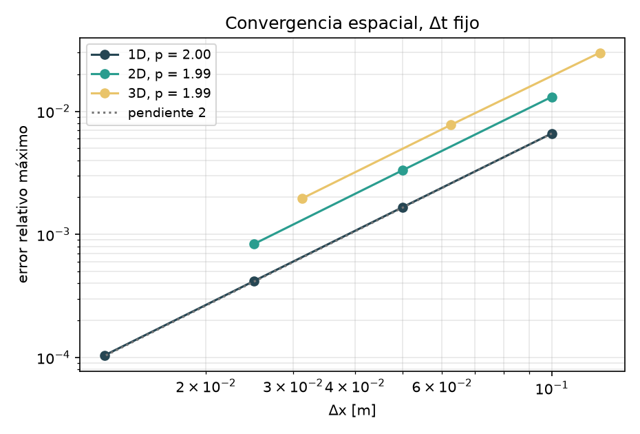
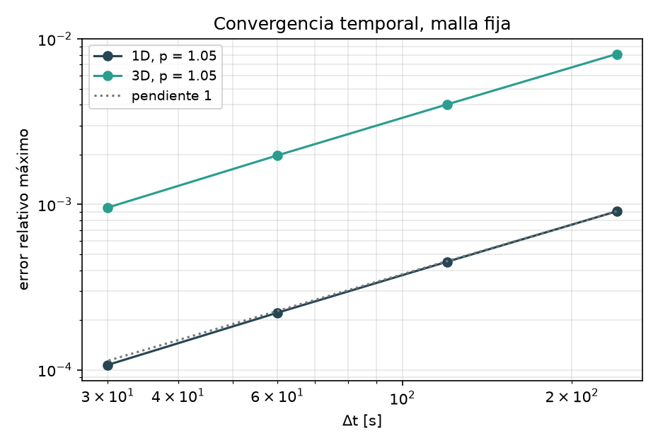
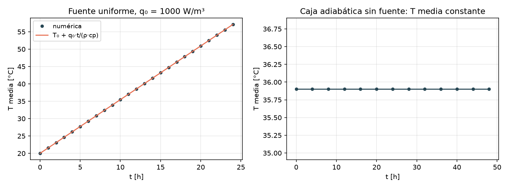
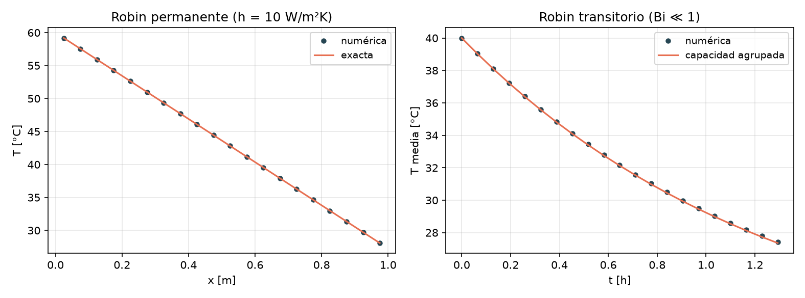
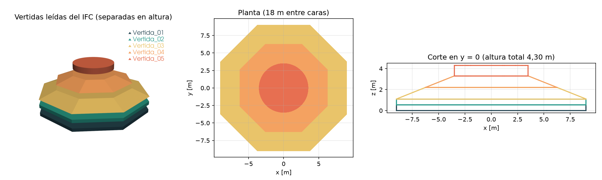

# E06 — Dossier de verificación + BIM del caso

**Grupo 5:** José Lobos, Clemente Sánchez y Matías Campos

**Repositorio:** https://github.com/jlobos-alt/MCOC-proyecto-2

**Commit evaluado:** el SHA declarado en Canvas junto a este dossier.

## 1. Conclusión

El solver 3D por balance de celdas reproduce todas las soluciones de referencia de la batería: 18 de 18 casos pasan, con orden espacial cercano a 2 y orden temporal cercano a 1, como corresponde al esquema. La energía se conserva hasta el redondeo. El BIM base contiene las 5 vertidas de la guía del curso y su volumen coincide con el cálculo analítico.

Esto es **verificación**: muestra que el programa resuelve bien la ecuación. Todavía no es validación contra el caso medido de Ju & Lei (2019), y los parámetros de hidratación siguen siendo provisorios.

## 2. Cómo reproducir

```powershell
pip install -r requirements.txt
python scripts/dossier_e06.py       # tablas y figuras de este dossier (~3 min)
python -m pytest tests -q           # 104 pruebas automáticas (~1 min)
```

Todo sale de `src/mcplan/verificacion.py` y usa `build_model` y `solve`, el mismo solver del caso real. Los resultados quedan en `results/e06/`. Las tablas de este documento se copiaron textualmente de esos archivos. El material es hormigón de Ju & Lei: k = 2,22 W/(m·K), ρ = 2400 kg/m³, cp = 970 J/(kg·K).

## 3. Matriz de verificación

| Test | Qué verifica | Error/métrica | Resultado |
|---|---|---|---|
| Seno 1D, Dirichlet | Difusión contra solución exacta | error rel. 9.93e-04 | PASA |
| Seno 2D, Dirichlet | Difusión contra solución exacta | error rel. 1.98e-03 | PASA |
| Seno 3D, Dirichlet | Difusión contra solución exacta | error rel. 2.98e-03 | PASA |
| Convergencia espacial 1D | Orden con Δt fijo = 20 s (Richardson) | p = 2.00 | PASA |
| Convergencia espacial 2D | Orden con Δt fijo = 40 s (Richardson) | p = 1.99 | PASA |
| Convergencia espacial 3D | Orden con Δt fijo = 40 s (Richardson) | p = 1.99 | PASA |
| Convergencia temporal 1D | Orden con n = 20 fijo | p = 1.05 | PASA |
| Convergencia temporal 3D | Orden con n = 12 fijo | p = 1.05 | PASA |
| Energía sin fuente | Caja adiabática, campo aleatorio: ΣCT constante | error rel. 0.0e+00 | PASA |
| Energía con fuente | E = E₀ + q₀·V·t | error rel. 3.7e-16 | PASA |
| Fuente uniforme | Subida lineal T₀ + q₀·t/(ρ·cp) | 3.6e-14 °C | PASA |
| Hidratación adiabática | Subida final θ∞ = 45 °C, con y sin madurez | 1.2e-10 °C | PASA |
| Neumann, balance | ΔE = −q_n·A·t | error rel. 5.1e-16 | PASA |
| Neumann + Dirichlet | Perfil permanente lineal | 4.8e-08 °C | PASA |
| Robin permanente | q = ΔT/(L/k + 1/h), perfil exacto | 4.6e-13 °C | PASA |
| Robin transitorio | Capacidad agrupada, Bi ≪ 1 | error rel. 2.70e-03 | PASA |
| Robin con h → ∞ | Tiende a Dirichlet | 3.2e-13 °C | PASA |
| Estabilidad 1D | Fo = 0,45 estable; Fo = 0,60 diverge | amplitud final: 0.1 y 4.0e+54 °C | PASA |

Los errores relativos de los casos con seno se dividen por la amplitud restante en el instante final. Así, un tiempo largo con el seno casi apagado no aprueba el caso por tener todo cerca de T₀.

Las pruebas automáticas agregan dos controles relevantes para la fundación real: una forma en L con Robin, que debe intercambiar calor por toda su superficie contra la solución de capacidad agrupada, y una caja con celdas vacías alrededor, que debe dar el mismo resultado que una caja que llena la grilla.

## 4. Convergencia espacial y temporal

| Refinamiento | Dimensión | Valores | Error relativo máximo | Orden p |
|---|---:|---|---|---|
| Espacial (n) | 1D | 10, 20, 40, 80 | 6.61e-03, 1.67e-03, 4.18e-04, 1.04e-04 | 1.99, 2.00, 2.00 |
| Espacial (n) | 2D | 10, 20, 40 | 1.31e-02, 3.33e-03, 8.35e-04 | 1.98, 1.99 |
| Espacial (n) | 3D | 8, 16, 32 | 2.99e-02, 7.75e-03, 1.95e-03 | 1.95, 1.99 |
| Temporal (Δt, s) | 1D | 240, 120, 60, 30 | 9.08e-04, 4.50e-04, 2.22e-04, 1.07e-04 | 1.01, 1.02, 1.05 |
| Temporal (Δt, s) | 3D | 240, 120, 60, 30 | 8.11e-03, 4.02e-03, 1.98e-03, 9.58e-04 | 1.01, 1.02, 1.05 |

**Espacial.** Se refina Δx con Δt fijo y se compara contra la solución exacta. El error de Euler tiene signo contrario al espacial y, en mallas finas, lo cancela en parte. Una primera medición directa dio p = 2,22 en 1D y 2,48 en 3D, valores mejores de lo que el esquema puede lograr. Por eso se usa la extrapolación de Richardson, 2·T(Δt/2) − T(Δt), que quita el término O(Δt) y deja solo el error espacial.



**Temporal.** Se refina Δt con la malla fija y se compara contra una corrida de la misma malla con Δt = 1,875 s, de modo que el error espacial no entra en la medida. El orden queda entre 1,01 y 1,05; la leve subida en el último refinamiento se explica porque ahí el error se acerca al de la propia referencia.



## 5. Energía, fuente y condición Robin

**Energía.** En una caja adiabática con campo inicial aleatorio, el calor que sale de una celda entra exactamente a su vecina, por lo que ΣC·T se mantiene hasta el redondeo. Con fuente, E = E₀ + q₀·V·t.

**Fuente.** Con T uniforme no hay flujos y cada celda cumple ρ·cp·dT/dt = q₀. La subida es lineal y Euler integra una recta sin error, salvo redondeo. Con q₀ = 1000 W/m³, sube 1,55 °C/h.



**Robin.** Se verifica en régimen permanente con resistencias en serie, en transitorio con capacidad agrupada (Bi ≪ 1) y en el límite h → ∞, que tiende a Dirichlet. El caso transitorio tiene el error mayor (0,27 %) porque la solución de referencia es aproximada: supone temperatura uniforme.



## 6. BIM base

**Archivo:** `geometry/foundation.ifc`, IFC4, versionado en el repositorio. **SHA-256** (con fin de línea LF): `d34acf78ffb42169c72b24d708aa8990f01e0831e8b6588f13258e19bc53a5d7`. Se puede regenerar la semilla con `python geometry/make_foundation_ifc.py`.

La estructura es `IfcProject > IfcSite > IfcBuilding > IfcBuildingStorey > 5 IfcFooting`. Cada vertida tiene identidad propia (GUID) y el set `UANDES_HormigonMasivo`, con unidades en metros.



| Vertida | z [m] | Ancho máx. en x [m] | V IFC [m³] | V Pset [m³] | Inicio [h] | T colocación [°C] |
|---|---|---:|---:|---:|---:|---:|
| Vertida_01 | 0.00–0.55 | 18.00 | 147.63 | 147.63 | 0 | 18 |
| Vertida_02 | 0.55–1.10 | 18.00 | 147.63 | 147.63 | 6 | 18 |
| Vertida_03 | 1.10–2.20 | 18.00 | 214.22 | 214.22 | 12 | 18 |
| Vertida_04 | 2.20–3.30 | 12.50 | 88.92 | 88.92 | 18 | 18 |
| Vertida_05 | 3.30–4.30 | 7.00 | 38.48 | 38.48 | 24 | 18 |
| **Total** | 0.00–4.30 | | **636.88** | **636.89** | | |

Volumen y dimensiones se midieron sobre la geometría que IfcOpenShell triangula desde el IFC. La diferencia con el Pset (636,88 contra 636,89 m³) proviene de que el cilindro de la vertida 5 se aproxima con facetas.

**Consistencia con la guía del curso.** Las dimensiones y los volúmenes coinciden con la guía. Para alinear el modelo con ella, se cambió el nombre del set de `Pset_HormigonMasivo` a `UANDES_HormigonMasivo`, porque el prefijo `Pset_` está reservado, y la secuencia pasó a una vertida cada 6 h. Después se volvió a guardar con Bonsai 0.9.0 en Blender 5.2.3, siguiendo el flujo `foundation_base.ifc` → Bonsai → `foundation.ifc`. Los GUID, las propiedades y los volúmenes se conservaron, y el reporte queda en `geometry/bonsai_report.txt`.

### Simplificaciones geométricas

1. **Geometría docente.** Es la de la guía del curso, inspirada en Ju & Lei (2019), porque el artículo no define el sólido por completo. Si el profesor entrega un IFC oficial, ese lo reemplaza.
2. **Altura total.** Es 4,30 m: 3,30 m de espesor central más un pedestal de 1,00 m, adoptado solo para el ejercicio. El espesor máximo del artículo es 3,30 m.
3. **Planta.** Octágono regular de 18 m entre caras, en vez del contorno real.
4. **Transición.** Dos troncos octagonales lineales, de 18 a 12,5 m y de 12,5 a 7 m entre caras.
5. **Espesor en el borde.** Constante, de 1,10 m, en todo el perímetro.
6. **Pedestal.** Cilindro de 7 m de diámetro sobre una plataforma octagonal de 7 m entre caras, facetado por el motor de geometría.
7. **Vertidas.** Separadas por planos horizontales, sin juntas inclinadas ni escalonadas. Las 5 piezas y su secuencia son el caso base, no el plan óptimo.
8. **Elementos omitidos.** Armadura, pernos de anclaje, ductos, moldaje como objeto y suelo. El moldaje y el suelo entran como condiciones de borde.
9. **Ubicación.** Centrada en el origen, con base en z = 0 y sin georreferenciar. El sitio se guarda aparte.

## 7. Limitaciones

- La batería verifica el solver en cajas y formas simples. La fundación real introduce frontera en escalera, cuyo error se estudia en la E07.
- El dossier se entrega después de la fecha del 30 de octubre. Por eso incluye las correcciones al solver hechas en la E07: las caras hacia celdas vacías y la integración del calor de hidratación en cada paso.
- No se verifica aún el modelo de clima, que se incorpora en E10–E12.
