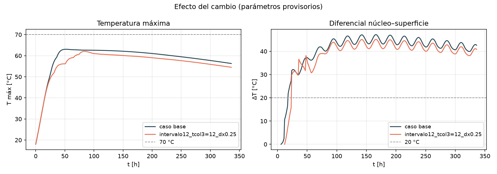

# E08 — Lab: pipeline IFC → simulación térmica por etapas (3 puntos)

**Objetivo:** demostrar el pipeline completo. **La secuencia está en los inputs, no en el solver:** sale del IFC y se puede cambiar por comando.

**Canvas:** solo `Repositorio` y `Commit evaluado`, sin texto adicional.

Carpeta autocontenida. Guion de la demo: [docs/E08_guion_lab.md](docs/E08_guion_lab.md).

## Preparar

```powershell
pip install -r requirements.txt
python -m pytest tests -q                  # 121 pruebas (~1 min)
python scripts/simular_fundacion_ifc.py    # caso base (~10 s)
```

## Lo que pide la entrega

| Requisito | Dónde | Evidencia |
|---|---|---|
| IFC | `geometry/foundation.ifc` | 5 vertidas, `UANDES_HormigonMasivo` |
| Extracción | `src/mcplan/bim.py`, `extraer_solidos` | Coincide con el volumen de cada Pset |
| Voxelización | `src/mcplan/voxel.py`, `voxelizar` | `results/e08/volumen/voxeles_cortes.png` |
| Visualización 3D | `src/mcplan/visualization.py`, `VisorVertidas` | `vista_3d.png`, `--visor`, serie `.vti` para ParaView |
| Dos vertidas o más con tiempos distintos | `InicioPlanificado` en el IFC | 0, 6, 12, 18 y 24 h, `activacion_cortes.png` |
| Fuente de hidratación | `src/mcplan/hydration.py` | Sube θ∞ exacto en caja adiabática (pruebas) |

| Rúbrica | Pts | Evidencia |
|---|---|---|
| Pipeline IFC→grid funcional | 0,9 | `simular_fundacion_ifc.py`: un solo comando del IFC al resultado |
| Convergencia geométrica y de volumen | 0,6 | `voxelizar_ifc.py`: tablas y `volumen_vs_dx.png` |
| Activación de vertidas + hidratación | 0,8 | `activacion_cortes.png`, `comparacion.png` y `tests/test_e08_pipeline.py` |
| Demo y explicación oral | 0,7 | [Guion](docs/E08_guion_lab.md) |

## Resultados

### Malla

Con Δz calzado a las interfaces entre vertidas (V IFC = 636,88 m³). **Los valores térmicos son provisorios: prueban la cadena, no concluyen sobre el plan.**

| Δx [m] | Δz [m] | Celdas | e_V total | T máx | Instante | ΔT máx | Instante |
|---|---|---:|---:|---:|---:|---:|---:|
| 0,5 | 0,55 | 4 656 | 0,52 % | 63,26 °C | 55 h | 44,50 °C | 192 h |
| 0,25 | 0,275 | 37 164 | 0,29 % | 63,06 °C | 52 h | 47,18 °C | 166 h |
| 0,125 | 0,1375 | 295 340 | 0,37 % | 62,93 °C | 53 h | 48,54 °C | 141 h |

T máx y su instante casi no cambian. **ΔT todavía no converge:** sube al refinar porque la superficie de control está en centros de celda, cada vez más cerca de la cara. Se resuelve en la E09, midiendo a 25 mm.

### Efecto de cambiar la secuencia

`--intervalo 12 --tcol 3=12`, con Δx = 0,25 m:

| Caso | T máx | Instante | ΔT máx |
|---|---|---|---:|
| Base: cada 6 h, todas a 18 °C | 63,06 °C | 52 h | 47,18 °C |
| Cada 12 h, vertida 3 a 12 °C | 62,03 °C | 84 h | 45,13 °C |
| Solo cada 12 h | 62,79 °C | 58 h | 46,66 °C |
| Solo vertida 3 a 12 °C | 61,89 °C | 62 h | 45,26 °C |

La baja de T máx viene sobre todo de enfriar la vertida 3, donde estaba el máximo. El intervalo de 12 h solo aporta 0,27 °C, y con Δx = 0,5 m ese efecto incluso cambia de signo (+0,13 °C): es del orden del error de malla. El retraso a 84 h ocurre porque el máximo pasa de la vertida 3 a la 5.



## Por qué se sabe que no está en el código

- `thermal.py` no contiene nombres de vertidas, fechas ni archivos IFC (hay una prueba para eso).
- El solver recibe un `Plan` y una `Voxelizacion`. `aplicar_cambios` solo cambia esos datos, sin tocar el IFC.
- Cambiar hora o temperatura cambia la activación y el resultado (pruebas `test_cambiar_...`).
- Cada corrida guarda en `corrida.json` la secuencia usada, la malla y el resultado.

## Limitaciones

- θ∞, τ, Ea/R y el clima son provisorios (E09–E12).
- ΔT se mide en centros de celda, no a 25 mm (E09).
- Con madurez, el esquema es de primer orden en Δt. Al bajar Δt de 3600 s a 225 s en el caso base, T máx cambia 0,08 °C y ΔT 0,18 °C.
- El moldaje es una capa común entre 0 y 72 h. Aún no se puede cambiar por vertida, ni aplicar la aislación (E10). En la defensa pueden pedirlo.
- El área en escalera queda cerca de 17 % sobre la real y no mejora al refinar.

## Evidencia / entrega (Canvas)

```
Repositorio: https://github.com/jlobos-alt/MCOC-proyecto-2
Commit evaluado: (el SHA declarado en Canvas)
```
