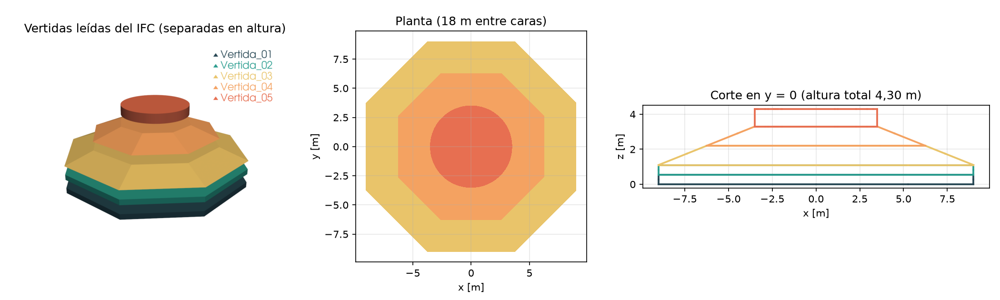
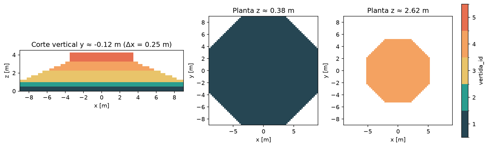
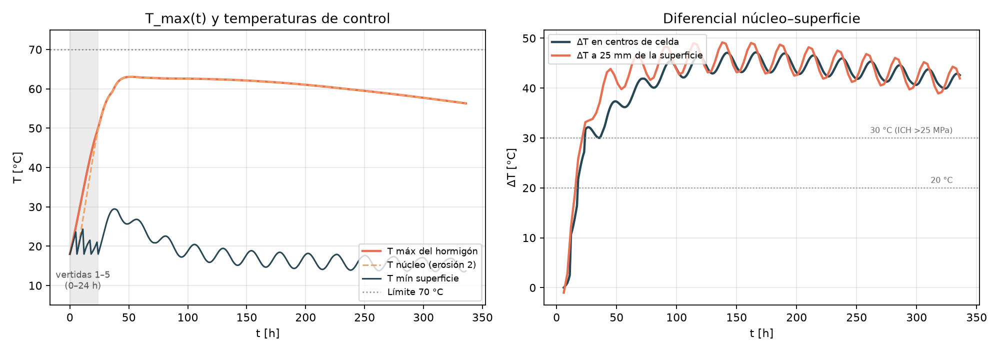
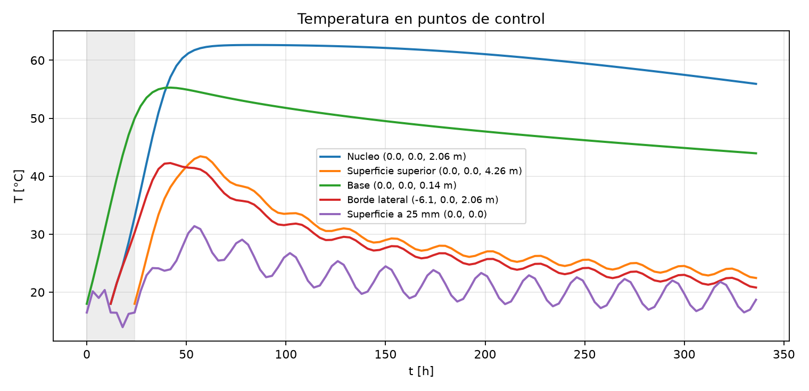
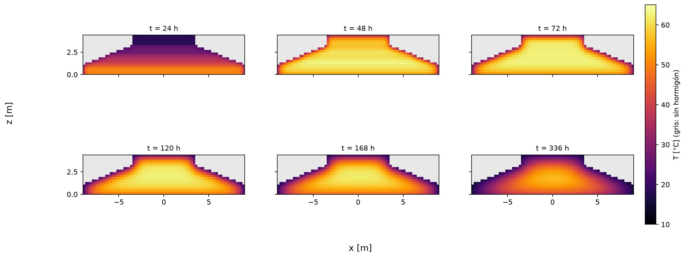
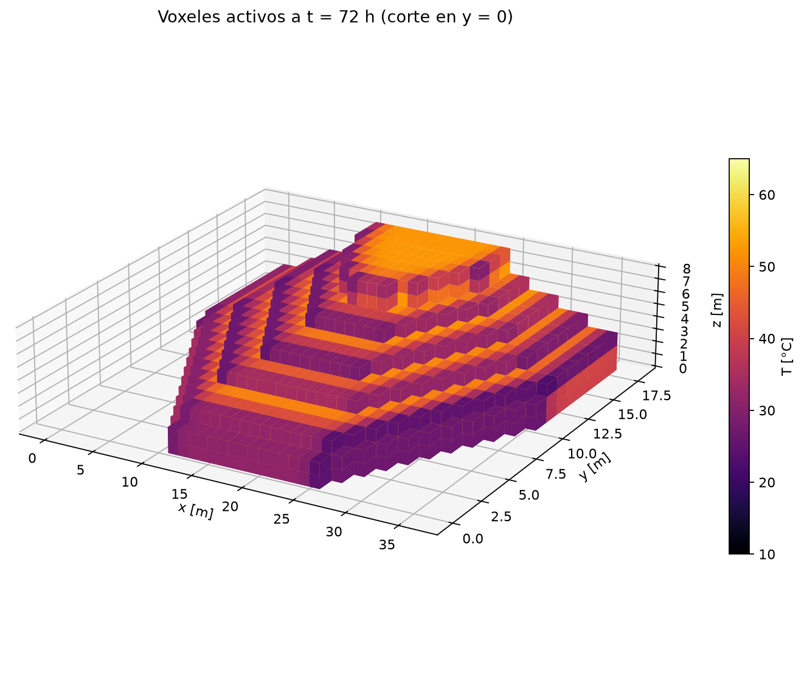

# E09 — Baseline 3D con hidratación

**Grupo 5:** José Lobos, Clemente Sánchez y Matías Campos

**Repositorio:** https://github.com/jlobos-alt/MCOC-proyecto-2

**Commit evaluado:** 7773d10

**Fecha:** viernes 6 de noviembre de 2026

## 1. Conclusión

Se ejecutó la primera simulación 3D del caso de referencia con geometría del IFC, cinco vertidas e hidratación con madurez de Arrhenius. El resultado es un baseline interpretable: la temperatura máxima llega a **63,06 °C a las 52 h** y el diferencial núcleo–superficie alcanza **47,18 °C** medido en centros de celda y **49,17 °C** estimado a 25 mm de la superficie. El modelo reproduce la forma y el orden de magnitud del comportamiento del paper de Ju & Lei (2019), pero todavía **no** su peak de 73 °C a los 4 días ni su ΔT cercano a 35 °C. Las diferencias se explican por parámetros de hidratación y clima aún provisorios, por un contorno superior más severo que el del paper y por la distinta geometría.

## 2. Geometría y BIM

La geometría sale de `geometry/foundation.ifc` (IFC4, 5 `IfcFooting`). Es un octágono regular de 18 m entre caras opuestas en la base, que se reduce en altura hasta un pedestal cilíndrico de 7 m de diámetro. La cota superior es 4,30 m: 3,30 m de fundación y 1,00 m de pedestal. El volumen geométrico es **636,88 m³**, coherente con los `Pset` de cada vertida.



*Figura 1. Modelo BIM del caso base: planta, elevación y vista 3D de las cinco vertidas.*

## 3. Voxelización y error de volumen

Se usó una grilla cartesiana de **Δx = Δy = 0,25 m** y **Δz = 0,275 m**, elegida para que las interfaces entre vertidas caigan en caras de celda. La grilla es de 72 × 72 × 16 y tiene **37 164 celdas activas**. El error de volumen se calcula como `e_V = |V_voxel − V_IFC| / V_IFC`.

| Vertida | Inicio [h] | T col. [°C] | V IFC [m³] | V voxel [m³] | e_V |
|---|---:|---:|---:|---:|---:|
| 1 | 0 | 18 | 147,63 | 146,44 | 0,81 % |
| 2 | 6 | 18 | 147,63 | 146,44 | 0,81 % |
| 3 | 12 | 18 | 214,22 | 214,71 | 0,23 % |
| 4 | 18 | 18 | 88,93 | 88,83 | 0,11 % |
| 5 | 24 | 18 | 38,48 | 42,35 | 10,07 % |
| **Total** | | | **636,88** | **638,76** | **0,29 %** |

El total es bajo, pero la vertida 5 concentra 10,07 % de error porque su cara superior cilíndrica no calza con Δz.



*Figura 2. Cortes de la voxelización: cada color es una vertida y cada celda tiene un único `vertida_id`.*

## 4. Vertidas y condiciones ambientales

Las cinco vertidas se colocan cada 6 h (0, 6, 12, 18 y 24 h), con temperatura de colocación de 18 °C. La secuencia y las temperaturas se leen del IFC (`InicioPlanificado` y `TemperaturaColocacion_C`); el solver no contiene nombres ni horas de obra.

Las condiciones ambientales son deliberadamente simples y quedan declaradas: aire **15 ± 5 °C** con período de 24 h, suelo a **12 °C**, convección de **h = 12 W/(m²·K)** en el perímetro y la superficie, y un encofrado de madera de 20 mm y k = 0,5 W/(m·K) en el perímetro durante las primeras 72 h. La base tiene una capa de suelo de 1 m y k = 1,389 W/(m·K). No se modelan radiación, viento ni curado superficial, y el encofrado es común a todas las vertidas.

## 5. Modelo de hidratación

El calor se obtiene de una elevación adiabática de un término, con madurez de Arrhenius:

$$\theta_{ad}(a)=\theta_\infty\left(1-e^{-a/\tau}\right),\qquad
\dot q_h=\rho c_p\,\frac{d\theta_{ad}}{da}\,m(T)$$

$$m(T)=\exp\left[-\frac{E_a}{R}\left(\frac{1}{T}-\frac{1}{T_{ref}}\right)\right],\qquad
a_{eq}(t)=\int_0^t m(T)\,d\tau$$

con θ∞ = 45 °C, τ = 30 h, Ea/R = 4000 K, Tref = 20 °C, ρ = 2400 kg/m³, cp = 970 J/(kg·K) y k = 2,22 W/(m·K). La ecuación que resuelve el solver es el balance de celdas:

$$\rho c_p\frac{\partial T}{\partial t}=\nabla\cdot(k\nabla T)+\dot q_h$$

y en las caras expuestas se aplica `−k ∂T/∂n = h(T − T_aire)`. Con θ∞ = 45 K y T col. = 18 °C, la cota adiabática es 63 °C; el máximo calculado (63,06 °C) coincide con ella, lo que confirma la coherencia del calor total.

## 6. Resultados térmicos



*Figura 3. T_max(t), temperaturas de control y ΔT en centros de celda y a 25 mm. Las líneas grises punteadas son los límites de 70 °C y 20/30 °C.*

La temperatura máxima es **63,06 °C a las 52 h** y luego decae lentamente. El ΔT en centros de celda llega a **47,18 °C a las 166 h**; estimado a 25 mm de la superficie sube a **49,17 °C a las 138 h**. Ambos superan el límite de 20 °C del curso y también el de 30 °C de la ICH para hormigones de más de 25 MPa.

| Punto de control | T máx [°C] | Instante [h] | T final [°C] |
|---|---:|---:|---:|
| Núcleo (0,0; 0,0; 2,06 m) | 62,63 | 84 | 55,93 |
| Superficie superior, centro de la 1.ª celda (0,0; 0,0; 4,26 m) | 43,44 | 57 | 22,45 |
| Base (0,0; 0,0; 0,14 m) | 55,28 | 42 | 43,95 |
| Borde lateral (−6,1; 0,0; 2,06 m) | 42,27 | 42 | 20,81 |
| Superficie a 25 mm (0,0; 0,0) | 31,40 | 54 | 18,70 |

El núcleo se mantiene sobre 60 °C entre 48 y 234 h, mientras la superficie superior baja de 43 °C a 22 °C en el mismo período. Esa separación sostenida es la que produce el ΔT alto.



*Figura 4. Evolución en los cuatro puntos de control.*



*Figura 5. Cortes en el plano y = 0 a 24, 48, 72, 120, 168 y 336 h.*



*Figura 6. Voxeles activos a 72 h, cortados en y = 0 y coloreados por temperatura.*

Los cortes muestran el frente térmico: a 24 h aún hay vertidas frías arriba; entre 48 y 72 h el núcleo alcanza su máximo; desde 120 h el enfriamiento entra por la superficie y el perímetro. La zona más caliente es el centro del bloque, no la cara superior.

## 7. Comparación cualitativa con Ju & Lei (2019)

| Característica del paper | ¿Se reproduce? | Comentario |
|---|---|---|
| Fundación de 18 m × 18 m y ~3,3 m de espesor | Sí, parcial | La base es 18 m; el espesor total es 4,3 m (3,3 + 1,0 m de pedestal). |
| Pedestal cilíndrico de 7 m de diámetro | Sí | Radio 3,5 m, sobre la fundación. |
| Peak de núcleo cercano a 73 °C | No | El modelo da 63,06 °C; faltan ~10 °C. |
| Peak cercano a 4 días | No | El modelo adelanta el peak a 52 h (~2,2 días). |
| ΔT núcleo–superficie cercano a 35 °C | No | El modelo da 47–49 °C, más severo. |
| Núcleo más caliente que la superficie | Sí | El núcleo es sistemáticamente más caliente que la superficie. |
| Construcción por vertidas | Sí | Cinco vertidas cada 6 h, leídas del IFC. |
| Efecto de la hidratación y la madurez | Sí, cualitativo | El calor total no depende de la temperatura; el peak se adelanta al calentar. |
| Aislación y curado superficial | No | El contorno superior es convectivo con h = 12 W/(m²·K), sin manta de curado. |
| Clima real del sitio | No | Aire sinusoidal genérico 15 ± 5 °C, no el clima de Chanco. |

**¿Qué reproduce y qué no?** El modelo reproduce la geometría de escala, la secuencia de vertidas, la forma de la curva (subida rápida, peak y enfriamiento lento), la existencia de un núcleo más caliente que la superficie y el orden de magnitud del calor de hidratación (θ∞ = 45 K). No reproduce el peak absoluto ni su instante, ni el ΔT del paper. Las causas son: (i) θ∞, τ y Ea/R son provisorios y no se calibraron contra las mediciones; (ii) el contorno superior no incluye aislación ni curado, por lo que la superficie se enfría de más y el ΔT crece; (iii) el ΔT del paper se mide con sensores internos, no a 25 mm; (iv) la geometría del curso es un tronco de octágono escalonado, más esbelto y de menor volumen que el raft prismático del paper.

## 8. Reproducibilidad

```powershell
cd entregas/entrega9
pip install -r requirements.txt
python scripts/baseline_e09.py
python scripts/simular_fundacion_ifc.py --salida results/e09/base --t 72 --corte --vti-cada-h 0
python -m pytest tests -q
```

`baseline_e09.py` guarda `results/e09/series_e09.csv` y `resumen_e09.json` con las series, la malla, los volúmenes y los parámetros. El entorno está en `environment.yml` y las versiones en `requirements.txt`.

## 9. Limitaciones y próximos pasos

- Hidratación y clima provisorios: falta calibrar θ∞, τ, Ea/R y usar el clima real de Chanco (E10–E11).
- El ΔT se informa en centros de celda y, como estimación, a 25 mm; falta un sensor virtual consistente con la instrumentación del paper.
- El encofrado es una capa común de 0 a 72 h; no se retira vertida por vertida ni se modela la aislación (E10).
- El error de volumen de la vertida 5 (10,07 %) se corrige refinando Δz o ajustando la cara superior del cilindro.
- Verificado, no validado: la comparación con Ju & Lei es cualitativa; la validación cuantitativa queda para E10–E12.

## Referencias

Ju, Y. y Lei, H. (2019). *Actual Temperature Evolution of Thick Raft Concrete Foundations and Cracking Risk Analysis*. Advances in Materials Science and Engineering, Article ID 7029671. https://doi.org/10.1155/2019/7029671

ICH (2019). *Especificación para Hormigón Masivo Estructural*. Instituto del Cemento y del Hormigón de Chile.
